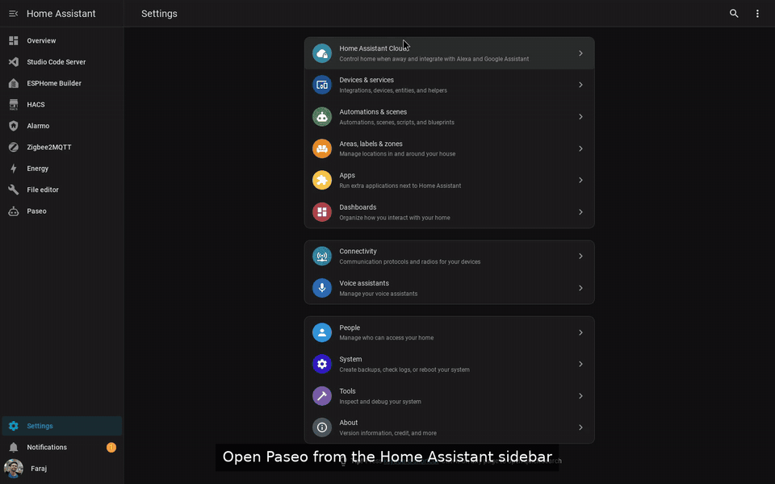

# Paseo Home Assistant Add-on

[](https://my.home-assistant.io/redirect/supervisor_app/?app=b498db88_paseo&repository_url=https%3A%2F%2Fgithub.com%2Ffarajfarook%2Fpaseo-ha-addon)
[](https://my.home-assistant.io/redirect/supervisor_add_addon_repository/?repository_url=https%3A%2F%2Fgithub.com%2Ffarajfarook%2Fpaseo-ha-addon)
[](https://github.com/farajfarook/paseo-ha-addon/releases)
[](LICENSE)


**Run Claude Code, Codex, Copilot, OpenCode, Pi and more inside Home Assistant, from the
sidebar or your phone, with a config check and git rollback built in.**

[Paseo](https://paseo.sh) is a self-hosted daemon and web UI for coding agents. This
add-on runs it on your Home Assistant box. It opens as a sidebar panel, and Home Assistant
handles the login. Agents start inside your Home Assistant configuration with live API
access. Ask for an automation. The agent edits the YAML, runs a config check, reloads the
domain and verifies the result against real entity states.

<p align="center">
  
</p>
<p align="center">
  <a href="https://youtu.be/jiKUqDyML24">&#9654; Watch the 80-second demo on YouTube</a>
</p>

## Why this add-on

- **Eight agents, your subscription.** Claude Code, Codex, GitHub Copilot, OpenCode, Pi
  (default), Oh My Pi, Muse Code (Meta) and Antigravity (Google). Pick any mix in one
  option and sign in with the plan or API key you already have.
- **A real UI, not a terminal in an iframe.** Chat, diffs, file explorer, terminals,
  permission prompts and optional voice, from Paseo's web UI. Works on a phone, and the
  Paseo iOS/Android/desktop apps connect through Paseo's encrypted relay or a direct port.
- **Always current.** Every selected agent CLI is installed at its latest stable release on
  each start, with automatic rollback if a new release does not run. No waiting for an
  add-on update to get a new Claude or Codex.
- **Knows Home Assistant.** Agents get the Core REST and WebSocket APIs, the `ha` CLI, the
  Home Assistant MCP server (auto-wired when enabled) and a bundled HA skill that enforces
  edit → `check_config` → reload → verify.
- **Undo button.** Optional git snapshots of `/homeassistant` so every agent change is a
  commit you can review or revert.
- **Sees your whole box.** `/homeassistant`, every add-on's config (Node-RED, ESPHome, …),
  `/share`, `/media`, `/backup`, plus `git`, `gh` and SSH keys for your dotfiles repo.
- **No second login.** Ingress uses your Home Assistant session. No ports, tokens or pairing
  unless you want remote access.

## Installation

Home Assistant renamed add-ons to **apps** in 2026.2. Same thing, new name. This repo
keeps "add-on" in its name because the Supervisor derives the app id from the repository
URL, so the URL has to stay put for existing installs.

1. Click the **Show app** badge above. It adds this repository to your Home Assistant if
   needed and opens the Paseo app page (Home Assistant 2026.3 or newer; on 2026.2 add the
   repository by hand first). Or do it by hand: go to
   **Settings > Apps > Install app**, open the **⋮** menu in the top right, pick
   **Repositories**, add `https://github.com/farajfarook/paseo-ha-addon` and close the
   dialog. Paseo then appears in the store under "Paseo for Home Assistant" (once #27 is merged; "Paseo Home Assistant Add-ons" before that).
2. Install **Paseo**, choose your `providers`, start it and enable **Show in sidebar**.
3. Open **Paseo** from the sidebar, start a terminal and run the agent's login
   (`claude`, `codex login`, `copilot login`, …) or put an API key in `env_vars`.

Requirements: Home Assistant OS or Supervised, 64-bit (`amd64` or `aarch64`, e.g.
Raspberry Pi 4/5), internet access on first start, and an account or API key for the
agents you select. The add-on itself is free.

Full setup, every option and the troubleshooting guide are in
[`paseo/DOCS.md`](paseo/DOCS.md).

## How it compares with the Claude Code terminal add-ons

Several community add-ons put Claude Code in a web terminal inside Home Assistant. They
proved people want this. This add-on is the next step:

| | Terminal add-ons | Paseo add-on |
|---|---|---|
| Agents | Claude Code only | 8, selectable, mixed |
| Interface | `ttyd` terminal in an iframe | Paseo web UI: chat, diffs, files, terminals, voice |
| Mobile | terminal in a phone browser | Paseo mobile apps via relay, or the web UI |
| Agent version | baked into the image | latest stable on every start, auto-rollback |
| HA awareness | manual | HA APIs, `ha` CLI, HA MCP server, bundled skill |
| Safety net | none | config check before reload, optional git snapshots |
| Other add-on configs | usually not mounted | `/addon_configs` read-write |

## Security, in one paragraph

Agents run as root in the container with read-write access to your live configuration
and a Home Assistant token with Supervisor `manager` rights. Anyone who can open the panel
can drive them. That is what makes the add-on useful and what makes it dangerous, so the
bundled guidance never exposes values from `secrets.yaml`, forbids editing `.storage/` while
Core runs, requires your approval before changing other add-ons or restarting Core, and
requires a config check before every reload. `git_snapshot` gives you a revert. Read [Security and trust model](paseo/DOCS.md#security-and-trust-model) before
you enable it, keep a backup, and give the panel only to people you trust with your home.

## FAQ

**Does my configuration leave my network?** Only what the agent you chose sends to its own
vendor (Anthropic, OpenAI, GitHub, Google, Meta, or your Pi model provider). If you turn on
dictation or voice mode with `speech_provider: openai`, speech and spoken replies go to
OpenAI as well. Paseo itself is self-hosted and has no telemetry. The optional relay is
end-to-end encrypted.

**What does it cost?** Nothing for the add-on. Agents use your existing subscription
(Claude Pro/Max, ChatGPT Plus/Pro, Copilot, Google, Meta) or API key.

**Which agent should I start with?** Pi is on by default and works with any model provider
via API key. Claude Code and Codex are the most popular for Home Assistant YAML.

**Can I use it from my phone?** Yes: the sidebar panel works in the HA companion app, and
Paseo's mobile apps pair over the relay (no port forwarding) or a password-protected direct
port.

**Does it support Raspberry Pi?** 64-bit Home Assistant OS on a Pi 4 or 5, yes. 32-bit
(`armv7`) is not supported, in line with Home Assistant OS 17.

## Versioning

Versions are `<paseo>-<rev>`: the bundled Paseo release plus an add-on revision. See
[`paseo/CHANGELOG.md`](paseo/CHANGELOG.md) and the
[GitHub releases](https://github.com/farajfarook/paseo-ha-addon/releases).

## Contributing and support

- Bugs and feature requests: [Issues](https://github.com/farajfarook/paseo-ha-addon/issues).
- Questions and show-and-tell: [Discussions](https://github.com/farajfarook/paseo-ha-addon/discussions).
- Paseo itself: [getpaseo/paseo](https://github.com/getpaseo/paseo).

If this saved you an evening, a star helps other Home Assistant users find it.

## License

Apache-2.0, matching upstream Paseo. See [LICENSE](LICENSE). Paseo is © the Paseo
authors; this add-on is not affiliated with or endorsed by the Paseo project.

---

<details>
<summary><strong>Maintainer notes: releasing and bumping Paseo</strong></summary>

## Releasing

Home Assistant installs the pre-built image whose tag equals `version` in
[`paseo/config.yaml`](paseo/config.yaml) on `main`
(`ghcr.io/farajfarook/{arch}-addon-paseo:<version>`). The version is
`<paseo>-<rev>`: the pinned Paseo release plus an add-on revision that resets to
`1` on every Paseo bump. Releasing is automatic once a bump reaches `main`:

1. On a branch, bump `version` in `paseo/config.yaml` (for example `0.10.3-2`, or
   `0.10.4-1` for a new Paseo release) and add a matching `## <version>` entry at
   the top of `paseo/CHANGELOG.md`. Lint warns on a PR that changes shipped files
   without a bump and fails if the changelog entry is missing. Wait for the Lint
   and Builder checks to pass.
2. Merge to `main`. The [Tag release](.github/workflows/tag.yaml) workflow sees the
   new version, creates the `v<version>` tag (skipping if it exists) and starts
   Publish.
3. [Publish](.github/workflows/publish.yaml) checks that the tag (minus `v`) equals
   `paseo/config.yaml` `version`, then pushes
   `ghcr.io/farajfarook/{amd64,aarch64}-addon-paseo:<version>` and `:latest`.
   Both take a few minutes.
4. When every image exists, Publish creates the GitHub Release with the
   `CHANGELOG.md` section for that version as its notes
   (`.github/scripts/release-notes.sh`).
5. To re-run a publish for an existing tag (or add a missing Release), use
   **Actions → Publish → Run workflow** and enter the tag (for example `v0.10.3-2`).
   Pushing a `v*` tag by hand also works.

Check a tag locally before pushing it:

```bash
.github/scripts/check-version.sh v0.10.3-2   # prints the version, or fails on mismatch
```

**First release only:** GHCR creates new packages as private. After the first
publish, open each of the two packages (`amd64-addon-paseo` and
`aarch64-addon-paseo`) under the repository's Packages, go
to **Package settings → Change visibility** and set it to **Public**. The
Supervisor pulls anonymously. Confirm with
`docker logout ghcr.io && docker pull ghcr.io/farajfarook/amd64-addon-paseo:<version>`.

Rules:

- Never push a `v*` tag for a version that isn't in `paseo/config.yaml` on
  `main`. The guard fails and nothing is published.
- Merging a version bump is the release. Until the images exist, users who see the
  new version get "image not found" when they update, so watch the Publish run.

## Bumping Paseo

The add-on does not fork Paseo. Its ingress adapter rewrites what the upstream web UI
emits, so it depends on Paseo internals: root-absolute asset paths, the hard-coded `/ws`
WebSocket path, the `window.__PASEO_INITIAL_DAEMON_CONNECTION__` hint, the
`paseo.bearer.<token>` subprotocol, and, for the stale-host heal, the `@paseo:daemon-registry`
and `paseo:last-workspace-route-selection` storage keys, the `/h/<serverId>/` routes and the
`$PASEO_HOME/server-id` file. A version bump that moves one of those silently breaks
the sidebar panel. Check them **before** raising the pin.

1. **Check the anchors of the candidate release** against the pinned one:

   ```bash
   ./.github/scripts/paseo-anchors.sh --diff <current> <candidate>   # e.g. --diff 0.10.3 0.11.0
   ```

   It downloads `@getpaseo/server` and `@getpaseo/protocol` for both versions and diffs a
   report of every fact the adapter relies on. Non-zero exit means an anchor moved. Use
   `.github/scripts/paseo-anchors.sh --installed` to print the report for the tree already
   installed.

2. **Diff the upstream sources** for the same files, plus the exported app shell, to see
   *why* something moved (paths are the same when only behaviour changed):

   ```bash
   BASE=https://raw.githubusercontent.com/getpaseo/paseo
   for tag in v0.10.2 v0.10.3; do           # the two versions you are comparing
     for f in packages/server/src/server/web-ui.ts \
              packages/protocol/src/daemon-endpoints.ts; do
       curl -fsSL -o "/tmp/$(basename "$f").$(tr . _ <<<"$tag")" "$BASE/$tag/$f"
     done
   done
   diff -u /tmp/web-ui.ts.v0_10_2 /tmp/web-ui.ts.v0_10_3
   diff -u /tmp/daemon-endpoints.ts.v0_10_2 /tmp/daemon-endpoints.ts.v0_10_3
   ```

   In the published package the exported `web-ui/index.html` and the bundle carry the same
   asset paths, and their file names are content-hashed - that is normal and is not an
   anchor change (the anchors report ignores hashes).

3. **If an anchor moved**, update the adapter before anything else:
   - `paseo/rootfs/opt/paseo-ha/nginx/paseo.conf.tpl` - the `sub_filter` list of
     root-absolute strings and the shim injection point.
   - `paseo/rootfs/opt/paseo-ha/www/shim.js` - the hint global, the `/ws` rewrite, the
     `/api/`, `/mcp/`, `/public/` fetch prefixes and the history/location mapping.
   - `paseo/rootfs/opt/paseo-ha/nginx/render.js` - the bearer header and WS subprotocol
     used for the direct-port password (design D4).
   - Record the new Paseo version's facts in `openspec/changes/.../design.md` D3.

4. **Re-pin and document**: `PASEO_VERSION` in `paseo/Dockerfile` and `paseo/build.yaml`
   (both must match), `HA_CLI_VERSION` if it moves with it, the add-on
   `version` in `paseo/config.yaml`, and a new `paseo/CHANGELOG.md` entry naming the Paseo
   version.

5. **Prove it works**: build amd64 and run the suites - `paseo/tests/smoke/run.sh` (curl
   level through the ingress adapter), `paseo/tests/agent-config/run.sh` and, when the
   adapter changed, `paseo/tests/ingress/run.sh` (browser behind a mock ingress). CI runs
   the same smoke test on every PR; **a bump is not done until that job passes.**

Baseline for the pinned release: `paseo-anchors.sh --diff 0.10.2 0.10.3` and
`--diff 0.10.3 0.11.0-beta.3` both report no anchor change, and `web-ui.ts` /
`daemon-endpoints.ts` are byte-identical between `v0.10.2`, `v0.10.3` and
`v0.11.0-beta.3`.

</details>
